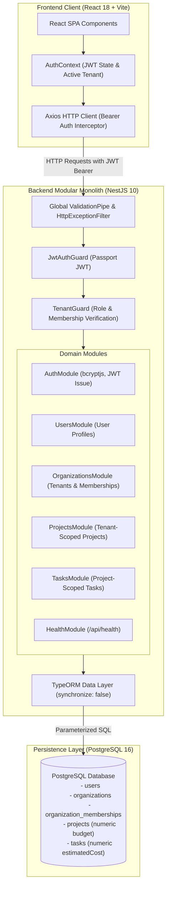
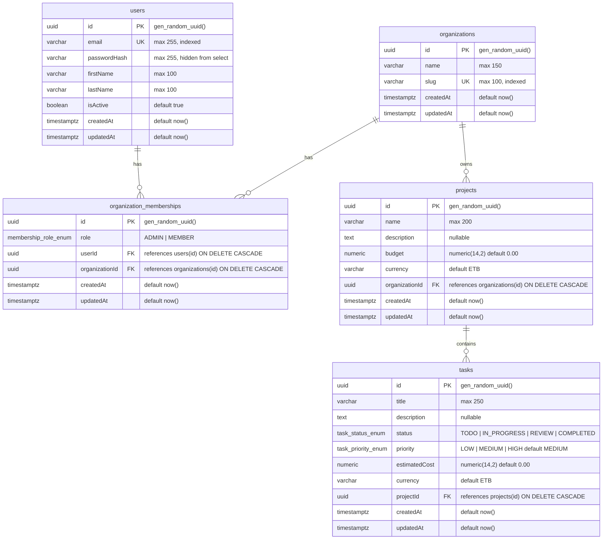
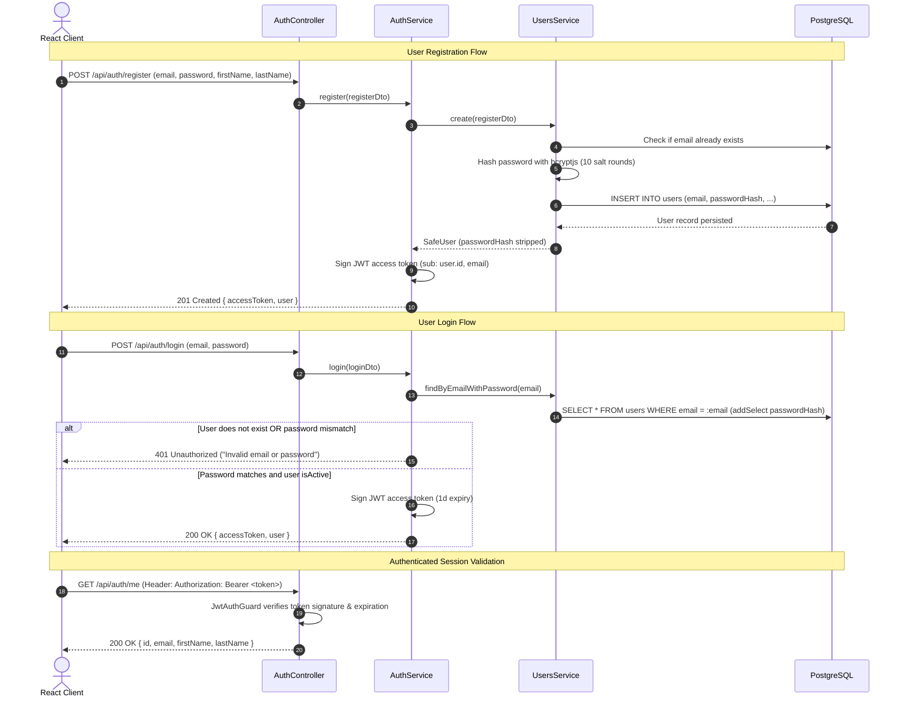
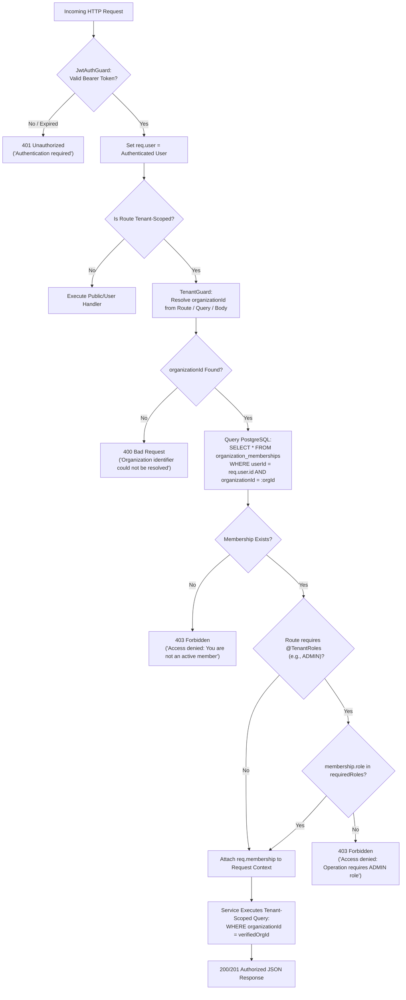
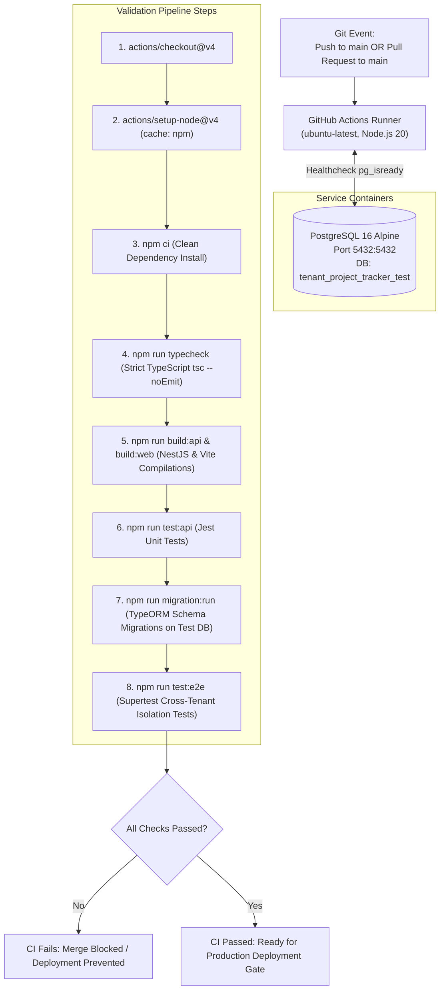

# Tenant Project Tracker

> Enterprise-grade, multi-tenant project and task management monorepo engineered with **NestJS**, **React + TypeScript + Vite**, and **PostgreSQL**. Demonstrates strict database-backed tenant isolation, role-based access control (RBAC), and high-precision Ethiopian Birr (ETB) financial arithmetic.

---

## Table of Contents

1. [Project Overview](#1-project-overview)
2. [Features](#2-features)
3. [Technology Stack](#3-technology-stack)
4. [System Architecture](#4-system-architecture)
5. [Database Design](#5-database-design)
6. [Authentication Flow](#6-authentication-flow)
7. [Organization Membership and RBAC](#7-organization-membership-and-rbac)
8. [Multi-Tenant Isolation and Authorization](#8-multi-tenant-isolation-and-authorization)
9. [API Documentation](#9-api-documentation)
10. [ETB Financial Precision](#10-etb-financial-precision)
11. [Frontend Architecture](#11-frontend-architecture)
12. [Automated Testing Strategy](#12-automated-testing-strategy)
13. [Database Migrations](#13-database-migrations)
14. [CI/CD Pipeline](#14-cicd-pipeline)
15. [Local Development Setup](#15-local-development-setup)
16. [Environment Variables](#16-environment-variables)
17. [Deployment](#17-deployment)
18. [Security Considerations and Production Hardening](#18-security-considerations-and-production-hardening)
19. [Assessment Walkthrough](#19-assessment-walkthrough)
20. [Known Limitations](#20-known-limitations)

---

## 1. Project Overview

The **Tenant Project Tracker** is a modular SaaS foundation designed for multi-organization project management and budget accountability. In multi-tenant systems, the paramount concern is **absolute data isolation**: under no circumstances may one organization read, modify, or infer the existence of another organization's projects, tasks, or financial allocations.

This application is built as a single **modular monolith** inside an `npm` workspaces monorepo. It rejects brittle client-side role assertions or naive query filtering in favor of authoritative, server-enforced security boundaries verified directly against PostgreSQL before any query executes.

### Core Objectives:
- **Authoritative Security**: Authentication via JWT and bcrypt; authorization via database-backed tenant guards.
- **Strict Tenant Boundaries**: Multi-organization memberships where users possess distinct, isolated permissions per tenant.
- **Monetary Soundness**: Financial figures stored in PostgreSQL `NUMERIC(14,2)` and manipulated with `decimal.js` to eliminate binary floating-point round-off errors.
- **Enterprise Engineering**: Zero `any` types, 100% strict TypeScript mode, explicit DTO validation pipes, and reversible database migrations with runtime schema synchronization disabled.

---

## 2. Features

- **Authentication & Identity**:
  - Secure registration and login with bcrypt password hashing (10 salt rounds).
  - JWT access tokens with generic error responses that defeat user-enumeration attacks.
  - Sanitized user profiles where sensitive fields (`passwordHash`) are never serialized.
- **Multi-Tenant Organization Management**:
  - Organizations are created only by a `PLATFORM_ADMIN`, who selects an existing user as the initial organization `ADMIN` (the creator is not auto-added).
  - Many-to-many relationship allowing users to join multiple independent organizations.
  - Organization switching on both frontend and backend.
- **Granular Role-Based Access Control (RBAC)**:
  - `ADMIN`: Full tenant lifecycle control (invite members, modify roles, create/update/delete projects, manage tasks).
  - `MEMBER`: Read-only tenant discovery, project inspection, task creation, and task status updates. Prohibited from member management or project deletion.
- **Project Tracking with ETB Budgets**:
  - Organization-owned projects with dedicated Ethiopian Birr (`ETB`) budgets.
  - Prevention of cross-tenant project lookups, ID manipulation, updates, and deletions.
- **Task Deliverable Management**:
  - Project-scoped tasks with estimated ETB deliverable costs and status states (`TODO`, `IN_PROGRESS`, `REVIEW`, `COMPLETED`).
  - Derived tenancy validation: task access strictly verifies parent project ownership.
- **Interactive Single-Page Application (SPA)**:
  - Responsive, dark-themed dashboard built with React 18, Vite, and Lucide icons.
  - Real-time client financial metric calculations (Budget, Allocated Cost, Remaining Budget, Utilization %).

---

## 3. Technology Stack

| Layer | Technology | Version | Purpose |
|---|---|---|---|
| **Backend Framework** | [NestJS](https://nestjs.com/) | `^10.3.3` | Modular monolith architecture, dependency injection, and request pipeline |
| **Backend Language** | [TypeScript](https://www.typescriptlang.org/) | `^5.3.3` | Strict type checking (`strict: true`, zero `any`) |
| **Database** | [PostgreSQL](https://www.postgresql.org/) | `16 / 18` | ACID relational persistence, foreign key cascades, and exact numeric types |
| **ORM** | [TypeORM](https://typeorm.io/) | `^0.3.20` | Entity mapping, query builder, and CLI-driven migrations |
| **Authentication** | [Passport JWT](http://www.passportjs.org/) / [bcryptjs](https://github.com/dcodeIO/bcrypt.js) | `^10.2.0` / `^2.4.3` | Stateless bearer authentication and cryptographic password hashing |
| **Validation** | [class-validator](https://github.com/typestack/class-validator) / [class-transformer](https://github.com/typestack/class-transformer) | `^0.14.1` / `^0.5.1` | Declarative payload validation and whitelist sanitization |
| **Financial Arithmetic** | [decimal.js](https://mikemcl.github.io/decimal.js/) | `^10.4.3` | Arbitrary-precision decimal arithmetic for ETB currency calculations |
| **Frontend Framework** | [React](https://react.dev/) | `^18.3.1` | Declarative component UI and reactive state management |
| **Frontend Tooling** | [Vite](https://vitejs.dev/) | `^5.2.11` | Ultra-fast HMR and optimized production bundling |
| **Client Routing** | [React Router DOM](https://reactrouter.com/) | `^6.23.0` | Client-side routing with nested protected layout boundaries |
| **HTTP Client** | [Axios](https://axios-http.com/) | `^1.7.2` | Typed HTTP requests with JWT bearer injection and 401 interception |
| **Testing** | [Jest](https://jestjs.io/) / [Supertest](https://github.com/ladjs/supertest) | `^29.7.0` / `^6.3.4` | Unit, integration, and live database cross-tenant security E2E testing |
| **Monorepo Manager** | [npm workspaces](https://docs.npmjs.com/cli/using-npm/workspaces) | `v10+` | Monorepo dependency hoisting and unified cross-package script execution |
| **Containerization** | [Docker Compose](https://docs.docker.com/compose/) | `Compose v2` | Containerized PostgreSQL service for local development and CI |

---

## 4. System Architecture

### Architectural Decisions & Trade-offs

1. **Modular Monolith vs. Microservices**:
   - *Decision*: A modular monolith was selected.
   - *Rationale*: Microservices introduce network latency, distributed transaction failure modes, complex serialization, and operational overhead. In early-to-mid stage multi-tenant applications, modular monoliths provide clear domain separation (via NestJS modules) while retaining compile-time type safety, zero-latency in-memory communication, and atomic PostgreSQL transactions.
2. **Monorepo Architecture (`npm` workspaces)**:
   - *Decision*: Host `apps/api` and `apps/web` within a single Git repository.
   - *Rationale*: Ensures synchronized CI pipelines, eliminates version drift between frontend DTO expectations and backend endpoints, and streamlines developer onboarding with a single `npm install`.
3. **Database-Backed Tenant Membership Verification**:
   - *Decision*: Every tenant-scoped request executes a database lookup against `organization_memberships` rather than relying on claims embedded in the JWT token.
   - *Rationale*: Embedding roles or organization lists in JWT tokens leads to stale permissions, vulnerability to token tampering, and inability to immediately revoke compromised accounts or removed members. Querying the membership table ensures immediate consistency.

### System Architecture Diagram



---

## 5. Database Design

### Architectural Decision: OrganizationMembership Join Entity
Instead of adding a single `organizationId` foreign key to the `users` table (which would restrict a user to exactly one tenant), multi-tenancy is modeled via an explicit `OrganizationMembership` join entity. 

This enables:
- A user to belong to multiple organizations simultaneously.
- A user to possess different roles in different organizations (e.g., `ADMIN` in Organization A, `MEMBER` in Organization B).
- Enforcement of the database-level uniqueness constraint `UQ_user_organization` on `(userId, organizationId)`.

### Entity Relationship Diagram (ERD)



### Table Definitions & Constraints
- **`users`**: Primary identifier is a UUID. `email` has a unique index (`IDX_users_email`). `passwordHash` is excluded from default queries via `@Column({ select: false })`.
- **`organizations`**: Unique slug column (`IDX_organizations_slug`) for tenant subdomains or clean URLs.
- **`organization_memberships`**: Unique constraint `UQ_user_organization` on `("userId", "organizationId")` prevents duplicate memberships. Indexed on both foreign keys.
- **`projects`**: Foreign key `organizationId` with `ON DELETE CASCADE`. Budget is stored as `numeric(14, 2)`.
- **`tasks`**: Foreign key `projectId` with `ON DELETE CASCADE`. Estimated cost is stored as `numeric(14, 2)`.

---

## 6. Authentication Flow

Authentication is stateless and based on JSON Web Tokens (JWT). Passwords are never saved in plaintext; they are hashed using `bcryptjs` with a work factor of 10.

### User Enumeration Defense
When authenticating via `/api/auth/login`, both a non-existent email and an incorrect password return an identical response:
```json
{
  "statusCode": 401,
  "timestamp": "2026-11-17T06:50:00.000Z",
  "path": "/api/auth/login",
  "method": "POST",
  "message": "Invalid email or password"
}
```
This prevents malicious actors from harvesting valid email addresses by analyzing error messages or status codes.

### Authentication Sequence Diagram



---

## 7. Organization Membership and RBAC

### Membership Lifecycle & Rules
0. **Two independent authorization levels**: `User.platformRole` (`PLATFORM_ADMIN` | `USER`) is application-wide; `OrganizationMembership.role` (`ADMIN` | `MEMBER`) is per organization. Being ADMIN of one organization grants no platform-level rights, and a user can be ADMIN in one organization and MEMBER in another. `platformRole` is read from the database on every request (never from the JWT or client input), cannot be set through registration, and is only granted by the seed/bootstrap script (see *Provisioning the first PLATFORM_ADMIN*).
1. **Creation**: Only a `PLATFORM_ADMIN` can call `POST /api/organizations` (others receive `403`). The body must include `initialAdminUserId`; in one database transaction the backend creates the organization and a single `ADMIN` membership for that user. The caller is **not** made a member.
2. **Invitation**: Only users with the `ADMIN` role in an organization can add members via `POST /api/organizations/:id/members`.
3. **Role Management**: Only `ADMIN` users can change another member's role via `PATCH /api/organizations/:id/members/:userId`. An organization must always keep at least one `ADMIN`: demoting the last one returns `409`. The check runs in a transaction holding a row lock on the organization, so concurrent role changes cannot both pass it. To hand over, promote the replacement first, then demote the old admin.
4. **Member Self-Add Prevention**: A user cannot self-join an organization without being invited by an active `ADMIN`.

### RBAC Permission Matrix

| Capability | ADMIN | MEMBER | Unauthenticated |
|---|:---:|:---:|:---:|
| Create New Organization | **No (403)** — requires platform role `PLATFORM_ADMIN` | **No (403)** — same | No (401) |
| View Organization Details & Members | Yes | Yes | No (401) |
| Add Members to Organization | Yes | **No (403)** | No (401) |
| Modify Member Roles | Yes | **No (403)** | No (401) |
| Create Projects in Organization | Yes | **No (403)** | No (401) |
| View Organization Projects | Yes | Yes | No (401) |
| Update / Delete Organization Projects | Yes | **No (403)** | No (401) |
| Create Tasks in Project | Yes | Yes | No (401) |
| Update Task Details / Status | Yes | Yes | No (401) |
| Delete Tasks | Yes | **No (403)** | No (401) |

---

## 8. Multi-Tenant Isolation and Authorization

### Zero-Trust Tenancy Principles
1. **Client Role Claims Are Ignored**: The backend never accepts role headers (e.g. `X-Role: ADMIN`). Roles are resolved strictly by looking up `(req.user.id, organizationId)` in the database.
2. **Client Organization IDs Are Verified**: If a client supplies an `organizationId` in a route parameter, query string, or body, `TenantGuard` intercepts the request, verifies that the user holds an active membership for that specific tenant, and blocks the request with `403 Forbidden` if they do not.
3. **No Global ID Retrieval**: The application never retrieves entities globally (e.g., `SELECT * FROM projects WHERE id = :id`) and then authorizes them afterward in memory. Ownership is verified at the query layer.
4. **Derived Task Tenancy**: For tasks, the organization boundary is derived from `task -> project -> organizationId`. A user cannot manipulate project or task IDs to cross organization boundaries.

### Tenant Authorization Flowchart



### Concrete Cross-Tenant Prevention Scenarios

- **Scenario 1: Listing Another Tenant's Projects**:
  - *Attack*: User A attempts `GET /api/projects?organizationId={Org_B_ID}`.
  - *Defense*: `TenantGuard` looks up `(User_A_ID, Org_B_ID)` in `organization_memberships`. Finding no match, it immediately halts execution and returns `403 Forbidden`.
- **Scenario 2: Guessing a Project ID Across Tenants**:
  - *Attack*: User A knows or guesses `Project_B_ID` and attempts `GET /api/projects/{Project_B_ID}`.
  - *Defense*: `ProjectsService.findById` executes:
    ```typescript
    const membership = await this.membershipRepository.findOne({
      where: { organizationId: project.organizationId, userId },
    });
    if (!membership) throw new ForbiddenException('Access denied: You do not have access to this project');
    ```
    User A is rejected with `403 Forbidden`.
- **Scenario 3: Cross-Tenant Task Injection**:
  - *Attack*: User A attempts `POST /api/tasks` supplying `projectId: Project_B_ID`.
  - *Defense*: `TasksService.create` inspects the project's owning organization and verifies User A's membership in `project.organizationId`. Since User A is not a member, it throws `403 Forbidden`.
- **Scenario 4: Task ID Manipulation**:
  - *Attack*: User A attempts `PATCH /api/tasks/{Task_B_ID}` to modify status or cost.
  - *Defense*: `TasksService.update` joins `task.project`, inspects `project.organizationId`, and validates caller membership. Cross-tenant access is rejected with `403 Forbidden`.

---

## 9. API Documentation

All API endpoints are prefixed with `/api`. Global error formatting is managed by `AllExceptionsFilter`.

> **Interactive Swagger UI**: When running the API server, the complete interactive OpenAPI documentation is available at **`http://localhost:3000/api/docs`**. You can authenticate directly in the UI using the **Authorize** button with your JWT Bearer token.

### Endpoint Reference Table

| Method | Endpoint | Description | Auth Required | Tenant Check | Role Required |
|---|---|---|:---:|:---:|:---:|
| `GET` | `/health` | Server uptime & database connectivity | No | None | Public |
| `POST` | `/auth/register` | Register new user profile | No | None | Public |
| `POST` | `/auth/login` | Authenticate user & receive JWT token | No | None | Public |
| `GET` | `/auth/me` | Fetch authenticated user profile | **Yes (JWT)** | None | Authenticated |
| `GET` | `/users` | List all users (feeds the initial-admin picker) | **Yes (JWT)** | `PlatformRolesGuard` | **PLATFORM_ADMIN** |
| `GET` | `/users/:id` | Own profile only (`403` for any other ID) | **Yes (JWT)** | Self-check | Authenticated |
| `POST` | `/organizations` | Create organization and assign its initial ADMIN | **Yes (JWT)** | `PlatformRolesGuard` | **PLATFORM_ADMIN** |
| `GET` | `/organizations[?take=:n&skip=:m]` | List caller organizations with pagination (`items`, `count`, `take`, `skip`) | **Yes (JWT)** | Scoped to User | Authenticated |
| `GET` | `/organizations/:id` | Get organization details | **Yes (JWT)** | `TenantGuard` | Member or Admin |
| `GET` | `/organizations/:id/members` | List members of organization | **Yes (JWT)** | `TenantGuard` | Member or Admin |
| `POST` | `/organizations/:id/members` | Add member to organization | **Yes (JWT)** | `TenantGuard` | **ADMIN** |
| `PATCH` | `/organizations/:id/members/:userId` | Update member role | **Yes (JWT)** | `TenantGuard` | **ADMIN** |
| `POST` | `/projects` | Create project in organization | **Yes (JWT)** | `TenantGuard` | **ADMIN** |
| `GET` | `/projects?organizationId=:id` | List organization projects | **Yes (JWT)** | `TenantGuard` | Member or Admin |
| `GET` | `/projects/:id` | Get project by ID | **Yes (JWT)** | Server-side scoped | Member or Admin |
| `PATCH` | `/projects/:id` | Update project details/budget | **Yes (JWT)** | Server-side scoped | **ADMIN** |
| `DELETE` | `/projects/:id` | Delete project | **Yes (JWT)** | Server-side scoped | **ADMIN** |
| `POST` | `/tasks` | Create deliverable task in project (priority: LOW, MEDIUM, HIGH) | **Yes (JWT)** | Server-side scoped | Member or Admin |
| `GET` | `/tasks?projectId=:id[&priority=:priority]` | List tasks in project (optional priority filter) | **Yes (JWT)** | Server-side scoped | Member or Admin |
| `GET` | `/tasks/:id` | Get task by ID | **Yes (JWT)** | Server-side scoped | Member or Admin |
| `PATCH` | `/tasks/:id` | Update task status, priority, or cost | **Yes (JWT)** | Server-side scoped | Member or Admin |
| `DELETE` | `/tasks/:id` | Delete task | **Yes (JWT)** | Server-side scoped | **ADMIN** |

---

### Request & Response Snippets

#### 1. User Registration (`POST /api/auth/register`)
**Request**:
```json
{
  "email": "abebe@addistech.et",
  "password": "StrongPassword123!",
  "firstName": "Abebe",
  "lastName": "Bikila"
}
```
**Response (`201 Created`)**:
```json
{
  "accessToken": "eyJhbGciOiJIUzI1NiIsInR5cCI6IkpXVCJ9...",
  "user": {
    "id": "e6a17b08-8df0-4b21-b4a8-6b83f51086c1",
    "email": "abebe@addistech.et",
    "firstName": "Abebe",
    "lastName": "Bikila",
    "isActive": true,
    "createdAt": "2026-11-17T06:45:00.000Z",
    "updatedAt": "2026-11-17T06:45:00.000Z"
  }
}
```

#### 2. Create Organization (`POST /api/organizations`)
**Header**: `Authorization: Bearer <PLATFORM_ADMIN token>` (other users receive `403`)  
**Request**:
```json
{
  "name": "Addis Tech Solutions PLC",
  "slug": "addis-tech",
  "initialAdminUserId": "a1b2c3d4-e5f6-4a8b-9c0d-1e2f3a4b5c6d"
}
```
**Response (`201 Created`)**:
```json
{
  "id": "3c842b08-f1c5-4d2b-8a56-8bf8df2410a5",
  "name": "Addis Tech Solutions PLC",
  "slug": "addis-tech",
  "initialAdmin": {
    "userId": "a1b2c3d4-e5f6-4a8b-9c0d-1e2f3a4b5c6d",
    "email": "owner@example.com",
    "firstName": "Abebe",
    "lastName": "Bikila"
  },
  "createdAt": "2026-11-17T06:46:00.000Z",
  "updatedAt": "2026-11-17T06:46:00.000Z"
}
```

#### 2.1. List Organizations with Pagination (`GET /api/organizations?take=10&skip=0`)
**Header**: `Authorization: Bearer <token>`  
**Response (`200 OK`)**:
```json
{
  "items": [
    {
      "id": "3c842b08-f1c5-4d2b-8a56-8bf8df2410a5",
      "name": "Addis Tech Solutions PLC",
      "slug": "addis-tech",
      "role": "ADMIN",
      "createdAt": "2026-11-17T06:46:00.000Z",
      "updatedAt": "2026-11-17T06:46:00.000Z"
    }
  ],
  "count": 1,
  "take": 10,
  "skip": 0
}
```

#### 3. Create Project with ETB Budget (`POST /api/projects`)
**Header**: `Authorization: Bearer <token>`  
**Request**:
```json
{
  "name": "Mobile Banking Platform",
  "description": "Core transaction processing engine",
  "budget": "650000.00",
  "organizationId": "3c842b08-f1c5-4d2b-8a56-8bf8df2410a5"
}
```
**Response (`201 Created`)**:
```json
{
  "id": "7b134d19-9c12-4a7b-b890-410a7c491de2",
  "name": "Mobile Banking Platform",
  "description": "Core transaction processing engine",
  "budget": "650000.00",
  "currency": "ETB",
  "organizationId": "3c842b08-f1c5-4d2b-8a56-8bf8df2410a5",
  "createdAt": "2026-11-17T06:47:00.000Z",
  "updatedAt": "2026-11-17T06:47:00.000Z"
}
```

#### 4. Create Task with Priority (`POST /api/tasks`)
**Header**: `Authorization: Bearer <token>`  
**Request**:
```json
{
  "title": "Core Database Indexing & Optimizations",
  "description": "Composite indexes on high-throughput query paths",
  "status": "IN_PROGRESS",
  "priority": "HIGH",
  "estimatedCost": "35000.00",
  "projectId": "7b134d19-9c12-4a7b-b890-410a7c491de2"
}
```
**Response (`201 Created`)**:
```json
{
  "id": "2d94e130-4c12-4a7b-b890-510a7c491de8",
  "title": "Core Database Indexing & Optimizations",
  "description": "Composite indexes on high-throughput query paths",
  "status": "IN_PROGRESS",
  "priority": "HIGH",
  "estimatedCost": "35000.00",
  "currency": "ETB",
  "projectId": "7b134d19-9c12-4a7b-b890-410a7c491de2",
  "createdAt": "2026-11-17T06:48:00.000Z",
  "updatedAt": "2026-11-17T06:48:00.000Z"
}
```

#### 5. Filter Tasks by Priority (`GET /api/tasks?projectId=:id&priority=HIGH`)
**Header**: `Authorization: Bearer <token>`  
**Response (`200 OK`)**:
```json
[
  {
    "id": "2d94e130-4c12-4a7b-b890-510a7c491de8",
    "title": "Core Database Indexing & Optimizations",
    "description": "Composite indexes on high-throughput query paths",
    "status": "IN_PROGRESS",
    "priority": "HIGH",
    "estimatedCost": "35000.00",
    "currency": "ETB",
    "projectId": "7b134d19-9c12-4a7b-b890-410a7c491de2",
    "createdAt": "2026-11-17T06:48:00.000Z",
    "updatedAt": "2026-11-17T06:48:00.000Z"
  }
]
```

#### 6. Standardized Error Response (`AllExceptionsFilter`)
**Response (`403 Forbidden`)**:
```json
{
  "statusCode": 403,
  "timestamp": "2026-11-17T06:48:00.000Z",
  "path": "/api/projects?organizationId=9f24e120-1a2b-4c3d-8e4f-5a6b7c8d9e0f",
  "method": "GET",
  "message": "Access denied: You are not an active member of this organization"
}
```

---

## 10. ETB Financial Precision

### The IEEE 754 Floating-Point Hazard
JavaScript standard `number` primitives are IEEE 754 double-precision floating-point numbers. In financial computations, binary representation errors compound rapidly:
```javascript
0.1 + 0.2 === 0.30000000000000004 // true
```
If financial budgets in Ethiopian Birr (ETB) are converted to native JavaScript numbers, cumulative sum differences lead to discrepancies during balance reconciliation and budget overrun alerts.

### The Solution: TypeORM Transformer & `decimal.js`
1. **Database Schema**: Fields are mapped to PostgreSQL `numeric(14, 2)`:
   - Up to 14 total digits with exactly 2 decimal digits (`999,999,999,999.99` ETB max capacity).
2. **Entity Transformer (`NumericTransformer`)**:
   ```typescript
   export class NumericTransformer implements ValueTransformer {
     to(data: string | number | null | undefined): string | null {
       if (data === null || data === undefined || data === '') return null;
       return new Decimal(data).toFixed(2);
     }
     from(data: string | null | undefined): string | null {
       if (data === null || data === undefined) return null;
       return new Decimal(data).toFixed(2);
     }
   }
   ```
3. **Application Layer**: Monetary properties (`budget`, `estimatedCost`) are typed and handled as exact 2-decimal strings (`"650000.00"`). Mathematical calculations utilize `Decimal`:
   ```typescript
   const remaining = new Decimal(project.budget).minus(totalEstimatedCost).toFixed(2);
   ```

---

## 11. Frontend Architecture

The frontend is located in `apps/web` and built with **React 18**, **TypeScript**, and **Vite**.

### Component & State Architecture
- **`AuthContext` (`apps/web/src/context/AuthContext.tsx`)**:
  - Global provider managing `user`, JWT `token`, `organizations` list, and `currentOrg`.
  - Exposes `login()`, `register()`, `logout()`, `switchOrganization()`, and `refreshOrganizations()`.
  - Persists session state to `localStorage`.
- **`AxiosClient` (`apps/web/src/services/api.ts`)**:
  - Automatically intercepts outgoing requests and adds `Authorization: Bearer <token>`.
  - Captures `401 Unauthorized` responses and flushes invalid sessions.
- **`ProtectedRoute` (`apps/web/src/components/ProtectedRoute.tsx`)**:
  - Wraps authenticated routes (`/dashboard`, `/projects`). Redirects unauthenticated visits to `/login`.
  - *Important*: Frontend route protection is treated purely as a UI convenience; the backend remains the sole authoritative security boundary.
- **Pages**:
  - `LoginPage`: Form validation, loading state, error alerts on invalid credentials.
  - `RegisterPage`: User registration only. New accounts belong to no organization until a platform administrator adds them.
  - `OrganizationDashboardPage`: Real-time member listing, role assignment modals, project creation modals (visible only to `ADMIN`).
  - `ProjectDashboardPage`: Project switcher, task deliverables table, live ETB budget utilization calculation.

---

## 12. Automated Testing Strategy

The project employs a multi-tiered test suite with Jest and Supertest.

### Test Database Configuration
Security and integration tests run against an actual PostgreSQL database instance on port `5433` (or port `5432` in CI). They execute real migrations, issue real SQL transactions, and verify database constraints (`UQ_user_organization`, foreign keys).

### Cross-Tenant Security Test Suite (`apps/api/test/tenant-isolation.e2e-spec.ts`)

The test suite configures:
- **User A** (`ADMIN` of Organization A).
- **User B** (`ADMIN` of Organization B).
- **User C** (`MEMBER` of Organization A).
- **User A** added as `MEMBER` to Organization B (verifying multi-tenancy).

| # | Test Scenario | Threat / Failure Mode Prevented | Verified Result |
|---|---|---|:---:|
| **1** | Unauthenticated requests rejected | Anonymous data leakage on protected endpoints | **Passed (401)** |
| **2** | Users can access own organization | False positive lockouts for legitimate tenant members | **Passed (200)** |
| **3** | User C cannot list Org B projects | Cross-tenant portfolio reconnaissance via parameter tampering | **Passed (403)** |
| **4** | User C cannot get Org B project by ID | Direct object reference (IDOR) project data breach | **Passed (403)** |
| **5** | User C cannot update/delete Org B project | Malicious tampering or destruction of rival tenant data | **Passed (403)** |
| **6** | User C cannot access tasks via Org B project | Task list enumeration or task injection into foreign projects | **Passed (403)** |
| **7** | User C cannot access Org B task by ID manipulation | Bypassing project validation by manipulating direct task UUIDs | **Passed (403)** |
| **8** | Regular MEMBER cannot perform ADMIN actions | Privilege escalation (non-admin inviting members or deleting projects) | **Passed (403)** |
| **9** | Multi-tenant user roles strictly enforced | Role pollution (holding ADMIN in Org A must not confer ADMIN rights in Org B) | **Passed (403/200)** |
| **10** | Platform admin creates an org for a chosen ADMIN and gains no membership | Platform role leaking into tenant access; orphan organizations | **Passed (201/200/403)** |

### Actual Test Execution Output

```text
PASS test/tenant-isolation.e2e-spec.ts
  Tenant Isolation & Cross-Tenant Security (e2e)
    √ 1. Unauthenticated requests are rejected with 401 Unauthorized (19 ms)
    √ 2. Users can access their own authorized organization (45 ms)
    √ 3. User C (not in Org B) cannot list Organization B projects (10 ms)
    √ 4. User C cannot retrieve Organization B project by ID (13 ms)
    √ 5. User C cannot update or delete Organization B project (17 ms)
    √ 6. User C cannot list or create tasks for another organization project (17 ms)
    √ 7. User C cannot read, update, or delete Organization B task by ID manipulation (29 ms)
    √ 8. Organization MEMBER cannot add members, modify roles, or delete projects (21 ms)
    √ 9. User A belongs to Org A (ADMIN) and Org B (MEMBER) and role permissions are strictly enforced per tenant (32 ms)
    √ 10. Platform admin creates an org for a chosen ADMIN and gains no membership in it

Test Suites: 1 passed, 1 total
Tests:       10 passed, 10 total
Snapshots:   0 total
Time:        5.178 s
```

### Running Tests

```bash
# Run unit tests across workspace
npm run test

# Run cross-tenant security E2E tests
npm run test:e2e
```

---

## 13. Database Migrations

### Why TypeORM Synchronize is Disabled
`synchronize: false` is strictly enforced in both runtime (`database.module.ts`) and CLI (`data-source.ts`) configurations. Automatic schema synchronization:
- Can silently drop columns, tables, or constraints in production.
- Prevents database rollback and revision auditing.
- Cannot safely backfill default values for existing production data.

### Migration Management

```bash
# Execute all pending migrations
npm run migration:run

# Revert the latest executed migration
npm run migration:revert

# Generate a migration based on entity changes
npm run migration:generate -- apps/api/src/database/migrations/YourMigrationName
```

### Implemented Migrations

#### 1. `1700000000000-InitialSchema.ts`
- Creates enums `membership_role_enum` (`ADMIN`, `MEMBER`) and `task_status_enum` (`TODO`, `IN_PROGRESS`, `REVIEW`, `COMPLETED`).
- Creates tables `users`, `organizations`, `organization_memberships`, `projects`, and `tasks`.
- Configures foreign keys with `ON DELETE CASCADE` and unique index constraints.

#### 2. `1700000001000-AddTaskPriority.ts` (Phase 3 - Implemented & Verified)
- **Enum Addition**: `CREATE TYPE "task_priority_enum" AS ENUM ('LOW', 'MEDIUM', 'HIGH');`.
- **Column Addition & Backfill**:
  ```sql
  ALTER TABLE "tasks" ADD COLUMN "priority" "task_priority_enum" NOT NULL DEFAULT 'MEDIUM';
  ```
  In PostgreSQL, adding a column with a `DEFAULT` constraint automatically backfills all existing task rows to `'MEDIUM'` with zero table rewrite downtime, while guaranteeing newly created tasks default to `'MEDIUM'` if priority is omitted.
- **Index Creation**: `CREATE INDEX "IDX_tasks_priority" ON "tasks" ("priority");` for fast query filtering.
- **Reversible Rollback (`down`)**:
  ```sql
  DROP INDEX IF EXISTS "IDX_tasks_priority";
  ALTER TABLE "tasks" DROP COLUMN IF EXISTS "priority";
  DROP TYPE IF EXISTS "task_priority_enum";
  ```
- **Rollback Data Loss Implications**:
  Executing `migration:revert` safely removes the `priority` column and type definition. While individual task priority classifications (`LOW`, `MEDIUM`, `HIGH`) are dropped, **all underlying tasks, titles, descriptions, statuses, ETB estimated costs, timestamps, and relationships remain 100% intact**. Existing tasks are neither deleted nor recreated.

---

## 14. CI/CD Pipeline

The project uses GitHub Actions (`.github/workflows/ci.yml`) to guarantee that every push or pull request to `main` satisfies all build, type-safety, and security requirements.

### Pipeline Flowchart



### Pipeline Guarantees
- **Live PostgreSQL Service**: A real `postgres:16-alpine` container is initialized on the runner.
- **Deployment Quality Gate**: Continuous deployment will only trigger on the `main` branch after 100% of the type checks, unit tests, migrations, and E2E isolation tests pass.
- **Current CD Status**: Continuous Integration is fully active. Continuous Deployment provider integration (e.g. Railway, Render, or AWS ECS) is deferred to the deployment hardening phase.

---

## 15. Local Development Setup

### Prerequisites
- **Node.js**: v20 or higher (`node -v`)
- **npm**: v10 or higher (`npm -v`)
- **PostgreSQL**: v16+ (or Docker / Docker Desktop)

### 1. Clone & Install Dependencies
```bash
git clone <repo-url>
cd Project-Tracker

# Install root and workspace dependencies
npm install
```

### 2. Configure Environment Variables
```bash
# Copy example configuration to .env
cp .env.example .env
```

### 3. Start PostgreSQL Database
```bash
# Start containerized PostgreSQL
npm run docker:db:up
```

### 4. Run Migrations
```bash
# Apply schema and task priority migrations
npm run migration:run
```

### 5. Seed Demonstration Data
```bash
# Seed initial organization, 2 members (Admin & Member), project, and tasks with ETB budgets
npm run seed
```

#### Provisioning the first PLATFORM_ADMIN
Organizations can only be created by a `PLATFORM_ADMIN`. There is no API that grants this role; it is provisioned server-side by the seed script from environment variables (never from source code):
```bash
# bash
PLATFORM_ADMIN_EMAIL=you@example.com PLATFORM_ADMIN_PASSWORD='<at least 12 characters>' npm run seed
# PowerShell
$env:PLATFORM_ADMIN_EMAIL='you@example.com'; $env:PLATFORM_ADMIN_PASSWORD='<at least 12 characters>'; npm run seed
```
The step is idempotent: it creates the user if missing, or promotes the existing user (without changing the password). If the variables are unset it is skipped. Existing users are migrated to `USER` by migration `AddUserPlatformRole1700000002000`; roll back with `npm run migration:revert`.

#### Pre-seeded Demonstration Credentials:
| Account Type | Email | Password | Organization | Tenant Role |
|---|---|---|---|:---:|
| **Admin User** | `admin@abyssinia.test` | `Password123!` | Abyssinia Technologies PLC | `ADMIN` |
| **Member User** | `member@abyssinia.test` | `Password123!` | Abyssinia Technologies PLC | `MEMBER` |

### 6. Verify Build and Test Suite
```bash
# Strict typecheck
npm run typecheck

# Full production build
npm run build

# Unit tests
npm run test

# Cross-tenant security E2E tests
npm run test:e2e
```

### 7. Start Development Servers
```bash
# Terminal 1: Start NestJS Backend (http://localhost:3000/api)
npm run dev:api

# Terminal 2: Start Vite React Frontend (http://localhost:5173)
npm run dev:web
```

---

## 16. Environment Variables

| Variable | Description | Default (Development) |
|---|---|---|
| `NODE_ENV` | Runtime environment (`development` / `production` / `test`) | `development` |
| `PORT` | API server HTTP port | `3000` |
| `API_PREFIX` | Global routing prefix | `api` |
| `POSTGRES_HOST` | Database host | `localhost` |
| `POSTGRES_PORT` | Database port | `5432` |
| `POSTGRES_USER` | Database username | `postgres` |
| `POSTGRES_PASSWORD` | Database password | `postgres` |
| `POSTGRES_DB` | Database name | `tenant_project_tracker` |
| `POSTGRES_SSL` | Enable SSL database connection (`true` / `false`) | `false` |
| `JWT_SECRET` | **Required, no default.** Signs JWT bearer tokens. The API refuses to start if it is missing, shorter than 32 characters, or a placeholder. Generate: `node -e "console.log(require('crypto').randomBytes(48).toString('hex'))"` | *(none)* |
| `JWT_EXPIRES_IN` | Token time-to-live | `1d` |
| `CORS_ALLOWED_ORIGINS` | Comma-separated browser origins allowed to call the API (exact match, no wildcard). Set it to the deployed frontend URL in production | `http://localhost:5173` outside production; none in production |
| `AUTH_RATE_LIMIT_MAX` | Max login requests and max registration requests per client IP per window (each limited separately) | `10` |
| `AUTH_RATE_LIMIT_WINDOW_MS` | Rate-limit window in milliseconds | `60000` |
| `TRUST_PROXY` | Set to `1` behind one reverse proxy so rate limiting uses each client's real IP | *(unset)* |
| `PLATFORM_ADMIN_EMAIL` / `PLATFORM_ADMIN_PASSWORD` | Read only by `npm run seed` to provision the first `PLATFORM_ADMIN` (password 12+ chars) | *(unset: step skipped)* |

**Development vs production**: in development copy `apps/api/.env.example` to `apps/api/.env` and fill in `JWT_SECRET` (the defaults for CORS and rate limiting suit local use). In production set every variable in the host's secret/environment manager (never in a committed file), use a different `JWT_SECRET` from development, set `NODE_ENV=production`, `CORS_ALLOWED_ORIGINS` to the exact frontend origin, and `TRUST_PROXY=1` if the host puts a proxy in front of the API. Rotating `JWT_SECRET` invalidates all issued tokens.
| `VITE_API_URL` | Base API URL consumed by React frontend | `http://localhost:3000/api` |

---

## 17. Deployment

### Production Build
Both backend and frontend produce compiled output ready for containerization:
```bash
# Compiles NestJS to apps/api/dist/ and Vite to apps/web/dist/
npm run build
```

### Containerization Strategy (Recommended Production Architecture)
- **API Service**: Multi-stage Dockerfile running `node dist/main.js` on Alpine Linux with non-root user.
- **Web Service**: Multi-stage Dockerfile serving `apps/web/dist/` through Nginx with HTTP/2 and gzip/brotli compression.
- **Database**: Managed PostgreSQL (AWS RDS, Cloud SQL, or Neon) with automated daily backups, SSL enabled (`POSTGRES_SSL=true`), and read-replicas.

---

## 18. Security Considerations and Production Hardening

### Implemented Security Controls
- **Bcrypt Password Hashing**: Hashed with 10 salt rounds; plaintext passwords are never logged or stored.
- **Zero-Trust Tenancy**: Database membership verification on every tenant-scoped operation.
- **SQL Injection Prevention**: Parameterized queries via TypeORM and query runners; no string-concatenated SQL.
- **Strict Payload Validation**: `ValidationPipe` with `whitelist: true` and `forbidNonWhitelisted: true` strips unexpected properties.
- **Startup Secret Validation**: no fallback JWT secret exists; the API will not start without a strong `JWT_SECRET`.
- **Strict CORS**: only origins in `CORS_ALLOWED_ORIGINS` receive CORS headers; no wildcard, and credentialed cross-origin requests are not enabled (authentication uses the `Authorization` header, not cookies).
- **Brute-Force Throttling**: `POST /auth/login` and `POST /auth/register` are limited per client IP (default 10 requests per minute each) and answer `429` with a `Retry-After` header beyond that.
- **Query Validation**: the task `priority` filter accepts only `LOW`, `MEDIUM` or `HIGH`; anything else returns `400`.

### Recommended Production Enhancements
1. **Refresh Token Rotation**: Transition from 1-day access tokens to 15-minute access tokens paired with rotated refresh tokens stored in HTTP-only, secure cookies.
2. **Distributed Rate Limiting**: the current limiter keeps counters in memory (fine for one instance). With several API instances, use a shared store such as Redis, and consider per-account lockout in addition to per-IP limits.
3. **Audit Logging**: Establish an immutable `audit_logs` table recording tenant actions (user invitations, role changes, project deletions).
4. **Soft Deletes**: Implement `@DeleteDateColumn` on `projects` and `tasks` to prevent catastrophic data loss from accidental deletions.
5. **Security Headers**: Integrate `helmet` to inject `Content-Security-Policy`, `X-Frame-Options`, and `Strict-Transport-Security`.

---

## 19. Assessment Walkthrough

Evaluators can follow this step-by-step walkthrough to test the multi-tenant platform:

1. **Start Services & Seed Data**:
   ```bash
   npm run docker:db:up
   npm run migration:run
   npm run seed    # Populates sample organization, 2 members, project & tasks
   npm run dev:api # In Terminal 1
   npm run dev:web # In Terminal 2
   ```
2. **Instant Login with Seeded Accounts**:
   - Navigate to `http://localhost:5173/login`.
   - **Log in as Admin**: `admin@abyssinia.test` / `Password123!`
     - Inspect **Abyssinia Technologies PLC** (`ADMIN` role).
     - Notice project **Mobile Banking Platform** with **750,000.00 ETB** budget, **550,000.00 ETB** allocated across 4 tasks (73.3%), and **200,000.00 ETB** remaining.
     - Test adding a new team member or project.
   - **Log in as Member**: `member@abyssinia.test` / `Password123!`
     - Inspect the dashboard with `MEMBER` role badge.
     - Notice project and task creation is accessible, but administrative settings and member deletion are prohibited.
3. **Open the Frontend**: Navigate to `http://localhost:5173`.
4. **Register User A & Create Tenant A (via Platform Admin)**:
   - Navigate to `/register` and register `Alice Admin` (`alice@tenanta.com`, `Password123!`). She starts with no organization and no organization-creation controls.
   - Log in as the platform administrator (see *Provisioning the first PLATFORM_ADMIN*), click **New Organization**, enter `Tenant A Corp` and select Alice as the initial administrator.
   - Result: Alice is `ADMIN` of `Tenant A Corp`; the platform administrator is not a member of it.
4. **Create Project in Tenant A**:
   - On the Organization Dashboard, click **New Project**.
   - Name: `Core Banking API`, Budget: `500000.00`.
   - View the project in the Projects view and add a task (`Database Migration`, cost: `45000.00`).
5. **Register User B & Create Tenant B**:
   - Logout and register a new user: `Bob Admin`, `bob@tenantb.com`, Org: `Tenant B Ltd`.
   - Verify that Bob sees **zero** projects or tasks from `Tenant A Corp`.
6. **Attempt Cross-Tenant Breach (API Verification)**:
   - Attempting to query `GET /api/projects?organizationId={Tenant_A_ID}` using Bob's token returns `403 Forbidden`.
7. **Run Automated Security Suite**:
   ```bash
   npm run test:e2e
   ```
   All 10 tenant isolation tests pass with 100% compliance.

---

## 20. Known Limitations

The following items are deferred to upcoming phases:
- **Refresh Token Rotation**: Single-token JWT architecture is active; refresh-token rotation is planned for deployment hardening.
- **Interactive Kanban Drag-and-Drop**: Frontend task status is currently managed via form selectors rather than a drag-and-drop board.
